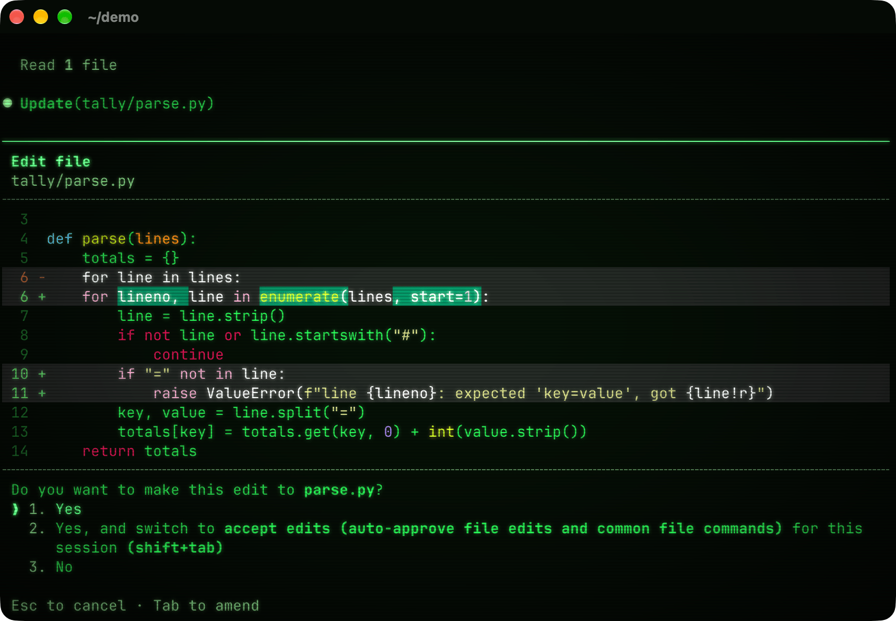
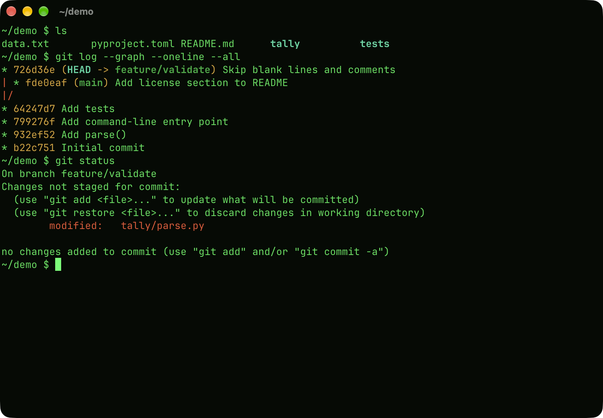
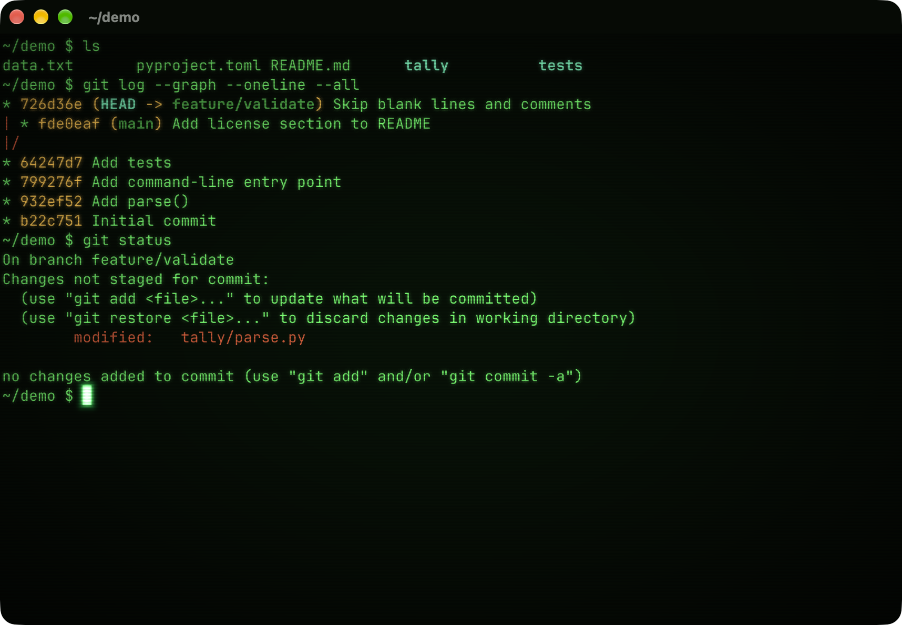
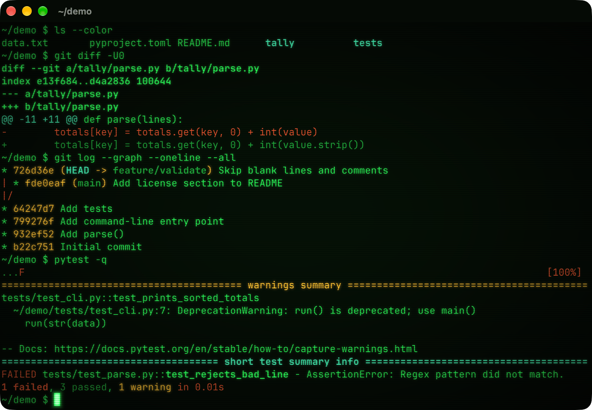
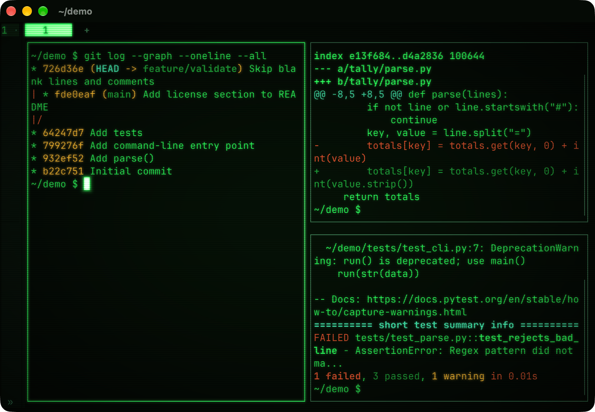
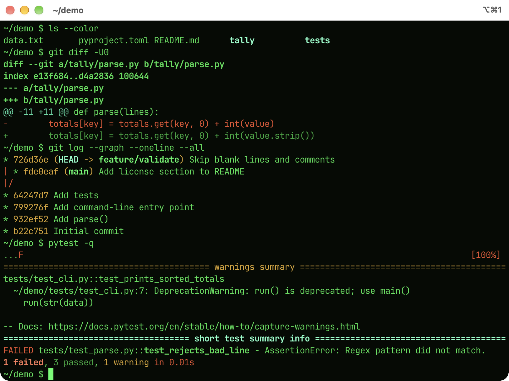
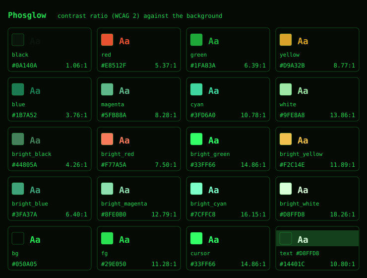

# Phosglow

Phosglow — a green phosphor CRT theme for terminals and AI coding tools.



Phosglow is one Palette of near-black and green with warm red and amber for
errors and warnings. It ships as Ports for four apps:

- **Ghostty**, with an optional CRT Shader (glow, scanlines, vignette, cursor halo)
- **Claude Code**, as a Plugin
- **herdr**, as a Plugin
- **iTerm2**, as a colour preset

Ports are best-effort. Each lists the app version it was verified with.

## Gallery

| Shader off | Shader on |
| --- | --- |
|  |  |



| herdr | iTerm2 |
| --- | --- |
|  |  |

## Install

Clone the repo for `./install.sh`. Run it with no arguments for a menu of
Ports, or name the Ports. `./install.sh --dry-run <port>` shows what would
change and changes nothing.

### Ghostty

```sh
./install.sh ghostty
```

Then reload the config (`Cmd+Shift+,` on macOS) or open a new window.

- `--no-crt` installs the colours without the Shader.
- `--ghostty-dir DIR` sets the Ghostty config directory (default `~/.config/ghostty`).
- Running it again is safe: files are overwritten and the config block is added once.

<details>
<summary>By hand</summary>

1. Copy `ports/ghostty/Phosglow` to `~/.config/ghostty/themes/Phosglow`.
2. Copy `ports/ghostty/phosglow.glsl` to `~/.config/ghostty/shaders/phosglow.glsl`.
3. Add these lines to `~/.config/ghostty/config.ghostty` (or `config`, on older installs):

   ```
   theme = Phosglow
   custom-shader = shaders/phosglow.glsl
   ```

</details>

Verified with Ghostty 1.4.0.

### Claude Code

In Claude Code 2.1.275 or newer, one step:

```
/plugin install phosglow --marketplace itigancov/phosglow
```

Or two steps:

```
/plugin marketplace add itigancov/phosglow
/plugin install phosglow@phosglow
```

Then pick **Phosglow (from phosglow)** in `/theme`, or set
`"theme": "custom:phosglow:phosglow"` in `~/.claude/settings.json`.

Without the plugin system, copy the theme instead: `./install.sh claude-code`,
then set `"theme": "custom:phosglow"`. On Windows, copy
`ports/claude-code/themes/phosglow.json` to `%USERPROFILE%\.claude\themes\`.
Use the copy or the plugin, not both: the picker would list two entries with the
same name.

- CLI only. The desktop app's Code tab does not show plugin themes, and its
  `/plugin` commands do something else. The VS Code extension was not tested.
- Plugin themes use Claude Code's `experimental.themes`, which may change.

Verified with Claude Code 2.1.332 (CLI).

### herdr

herdr cannot load a theme from a Plugin, so the Plugin adds an action that
applies the colours to your config.

```sh
herdr plugin install itigancov/phosglow/ports/herdr
herdr plugin action invoke apply --plugin itigancov.phosglow
```

The action is "Apply Phosglow". From a clone, use
`herdr plugin link ports/herdr` instead of `install`.

Without plugins, `./install.sh herdr` prints a snippet to paste under `[theme]`
in `~/.config/herdr/config.toml`; then run `herdr server reload-config`.

The main pane keeps your terminal's background, so it is not green unless your
terminal is. herdr's TUI only.

Verified with herdr 0.9.5.

### iTerm2

1. Open iTerm2 > Settings > Profiles > Colors.
2. Open the Color Presets... menu and choose Import...
3. Select `ports/iterm2/Phosglow.itermcolors`.
4. Open Color Presets... again and choose Phosglow.

If *Use separate colors for light and dark mode* is on, apply the preset in each
mode or turn the option off.

`./install.sh iterm2` prints these steps with the full path.

Verified with iTerm2 3.7.9.

## Palette



<!-- palette:start -->
| Role | Hex |
| --- | --- |
| `bg` | `#050A05` |
| `fg` | `#29E050` |
| `cursor` | `#33FF66` |
| `selection_bg` | `#14401C` |
| `selection_fg` | `#D8FFD8` |

| Colour | Normal | Bright |
| --- | --- | --- |
| black | `#0A140A` | `#44805A` |
| red | `#E8512F` | `#F77A5A` |
| green | `#1FA83A` | `#33FF66` |
| yellow | `#D9A32B` | `#F2C14E` |
| blue | `#1B7A52` | `#3FA37A` |
| magenta | `#5FB88A` | `#8FE0B0` |
| cyan | `#3FD6A0` | `#7CFFC8` |
| white | `#9FE8A8` | `#D8FFD8` |
<!-- palette:end -->

### Contrast

Against the background, the foreground, the cursor and the selection text
(on the selection background) all pass WCAG AA (4.5:1). 13 of the 16 ANSI
colours reach 4.5:1. The other three are deliberately muted: `black`, `blue`
and `bright black`. If text in those is hard to read, raise Ghostty's
`minimum-contrast` (for example `minimum-contrast = 4.5`).

## Shader

Ghostty only. The Shader adds a soft glow, scanlines, dark corners with a lit
centre, an amber glow for warnings and a softly pulsing cursor. Edit the
constants at the top of `ports/ghostty/phosglow.glsl`:

- `BLOOM_STRENGTH`, `SCAN_DEPTH`, `VIGNETTE`, `CENTER_LIFT`: glow, scanline
  depth, corner darkness and the green lift in the middle.
- `HOT_BOOST`: extra glow for the brightest green pixels, such as the Claude
  Code mascot. White and grey text gets the normal glow.
- `CURSOR_PULSE`: set `0.0` for a steady cursor halo. `FLICKER` is off by default.
- `SCAN_PERIOD` is in physical pixels. Raise it on Retina screens if the
  scanlines look too fine.

The cursor halo needs Ghostty 1.2 or newer (it uses the cursor uniforms).

## Notes

- **Dark only.** There is no light variant.
- **Shaders stack.** If you already have a `custom-shader`, both run. Remove
  the other one if the result looks muddy.
- **Effects not showing?** The Shader probably failed to compile. Ghostty
  writes shader errors to its log and does not report them as config errors.
- **Red-green colour blindness.** Errors (red, amber) differ from green by hue
  and luminance, but red-green colour blindness weakens that. Raise
  `minimum-contrast` in Ghostty.
- **Ports are best-effort.** Each lists the app version it was verified with.

## Uninstall

- **Ghostty:** `./install.sh --uninstall ghostty`, or delete the
  `# >>> phosglow >>>` block from your config and the theme and Shader files.
- **Claude Code:** first reset `theme` in `~/.claude/settings.json` (or pick
  another with `/theme`), then `/plugin uninstall phosglow@phosglow`. For the
  copy: `./install.sh --uninstall claude-code`.
- **herdr:** run "Remove Phosglow"
  (`herdr plugin action invoke remove --plugin itigancov.phosglow`), then
  `herdr plugin uninstall itigancov.phosglow`. For the pasted snippet, delete
  the `[theme.custom]` section and run `herdr server reload-config`.
- **iTerm2:** Color Presets... > Delete Preset... > Phosglow.

## Contributing

See [CONTRIBUTING.md](CONTRIBUTING.md). Changes are listed in
[CHANGELOG.md](CHANGELOG.md).

## License

[MIT](LICENSE)
